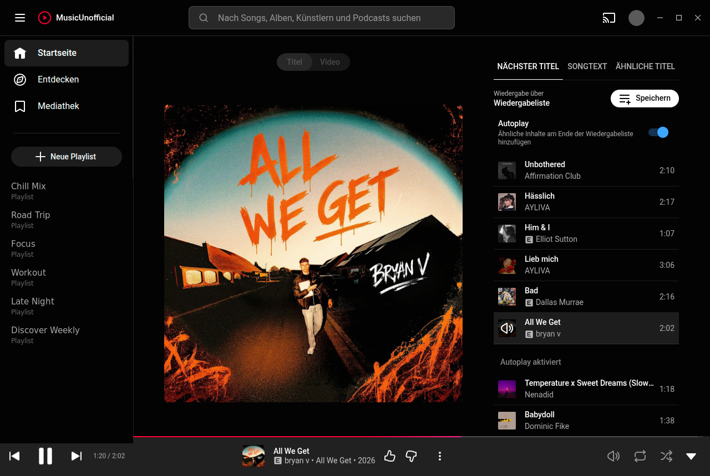
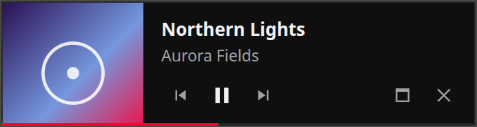

<div align="center">


# MusicUnofficial

**An unofficial desktop app for the YouTube Music player on Linux.**

</div>

---

## Please read first

> **This is not an official YouTube or Google product.**
>
> This project is **not affiliated with, endorsed by, sponsored by, or connected
> to Google LLC or YouTube** in any way. It is an independent, unofficial
> third-party application.
>
> YouTube, YouTube Music and the YouTube logo are trademarks of Google LLC. They
> are referenced here only to describe what this application is for.
>
> The application does not host, store, distribute or modify any music or video
> content. It loads the public YouTube Music website in a browser view inside its
> window and plays from there, exactly as any web browser would; its own
> interface shows that page's content and drives its player. Your account, your
> subscription and everything you play remain entirely between you and YouTube.
> Advertising plays as served, nothing is blocked or bypassed.
>
> **For anything concerning your account, your subscription, billing or content
> availability, contact YouTube support. This project cannot help with those and
> has no access to them.**

---

<div align="center">



<sub>Signed out, on an artist page.</sub>

</div>

## What it is

A desktop interface in front of `music.youtube.com`. The site plays out of sight
inside the app's window; the app shows home, explore, your library, search,
playlists, the queue and lyrics and drives the site's player. Clicking the cover
opens the now-playing view with the site's own player, the cover or the music
video. Sign-in, Premium, recommendations and the queue stay YouTube's, because
everything goes through the site itself. Google's consent page and the sign-in
open in the same window when they are needed; `Sign in` in the header is there
while no account is signed in.

It deliberately does not try to be a music suite. There are no plugins, no
themes, no downloader, no ad blocker and no telemetry. The interface relies on
internals of the site, so a YouTube update can break a part of it until the app
catches up.

## Features

| | |
|---|---|
| Own interface | Home, explore, library, search with suggestions, playlists, an editable queue and lyrics, in German or English |
| Player bar | Seek, shuffle, repeat, like, volume and the song or video switch, all mirrored from the site's own bar |
| Mini player | A small window with cover, title and playback controls, on top of other windows |
| Media keys | Registered with MPRIS as Music, including the GNOME media widget and the lock screen |
| Discord | Rich Presence, on by default, switched off in the settings or from the tray |
| Extras | Sleep timer, a notification on a new track, Last.fm scrobbling with an API account of your own. Scrobbles made offline are sent once Last.fm is reachable again |
| Tray | Closing the window keeps playback running. The icon shows the track and offers play, pause and skip; quit from the tray or with `Ctrl+Q` |
| Remembers itself | Window size, maximised state, zoom and the last opened page are restored on the next start, the window position too on X11. The last track comes back paused where it stopped, if that was less than a week ago |
| Stays signed in | The profile survives updates, so an update does not sign you out |
| Installs like any app | A `.deb` for Debian, Ubuntu and their derivatives; new versions install themselves after a password prompt |
| Dependencies | Electron plus one small pure JavaScript D-Bus library for the media keys |

## Mini player

<div align="center">



</div>


`Ctrl` `M`, the button in the navigation bar or the tray entry shrinks the app
to a small window that stays above every other window. It shows the cover art,
the track, the artist, a progress bar and play, previous and next.

Drag it anywhere by its background; on X11 it comes back where you left it. The two
buttons on the right go back to the full window and quit the application. There
is no third button that only closes the mini player: with the main window
hidden behind it, that would leave no way out on a desktop whose tray does not
render.

The progress bar tracks the player rather than approximating it. Every reading
carries the moment it was taken, so the bar and the Discord countdown project
from that instant instead of from whenever the message happened to arrive.
Seeking is picked up from the player's own events, so the bar jumps with the
track rather than catching up a second later.

On a Wayland session GNOME decides where a window opens and does not let an
application keep itself on top. Press `Alt` `Space` on the mini player and pick
"Always on Top" to pin it there. The app runs on native Wayland because XWayland
reports a wrong refresh rate for high refresh rate monitors and everything then
draws at 20 frames per second.

Track information comes from the page's own `mediaSession` data, the same
source the media keys and the desktop's media widget use, so it does not depend
on the site's markup staying the way it is today. The page reads the player once
a second while a window shows the track and every three seconds in the
background, and reports only what changed. The fast rate costs about 0.2 % of
one core.

## Discord Rich Presence

On by default: what you are listening to appears on your Discord profile.
Untick it in the settings or `Discord Rich Presence` in the tray menu to switch
it off.

It talks to Discord's local socket directly, with no third-party library and no
network access. Only title, artist, album and cover art are sent, and only
while something is playing. Switching it off clears the presence immediately.

If Discord is not running, restarts or refuses the connection, the app retries
quietly every 15 seconds until it gets through.

> There is no Snap for this reason: under strict confinement Discord's local
> socket sits outside the sandbox and AppArmor blocks the connection.

## Keyboard shortcuts

| Shortcut | Action |
|---|---|
| `Ctrl` `Q` | Quit |
| `Ctrl` `M` | Mini player |
| `Ctrl` `R` | Reload the window |
| `Space` | Play or pause |
| `←` / `→` | Back or forward 10 seconds |
| `Shift` `←` / `Shift` `→` | Previous or next track |
| `+` / `-` | Volume up or down, also the mouse wheel on the volume slider |
| `M` | Mute |
| `L` | Like |
| `/` | Search |
| `Ctrl` `+` / `Ctrl` `-` | Zoom in and out, kept across restarts |
| `Ctrl` `0` | Reset zoom |

The player keys work everywhere except in text fields and menus. The settings
page lists them too.

Media keys are handled by the desktop through MPRIS and need no configuration.

## Install

Download `musicunofficial_X.Y.Z_amd64.deb` from the releases page. Opening the
file usually hands it to the software centre, which installs it after asking
for your password. In a terminal:

```bash
sudo apt install ~/Downloads/musicunofficial_*_amd64.deb
```

Music then shows up in the app menu. `sudo apt remove musicunofficial` takes it
out again; sign-in and settings stay in `~/.config/musicunofficial`.

### Updates

A minute after start and every six hours the app looks for a newer GitHub
release. It downloads the package, checks it against the sha256 digest GitHub
lists for it and offers it under Settings > Updates. "Install and restart" asks
for your password, checks the package once more as root, installs it with dpkg
and starts the new version. A development run never updates itself.

### Requirements

Debian, Ubuntu or a distribution based on them, on x86_64. A tray icon requires a status area; on plain GNOME that means the AppIndicator
extension. Without it the application still runs and closing the window quits
normally.

## Build from source

```bash
npm install
npm test
npm run build
```

The package lands in `dist/musicunofficial_X.Y.Z_amd64.deb`. Icons are generated
from a single source file:

```bash
npm run icons
```

Edit `assets/symbol.svg` and run the command to regenerate the application icon,
the tray icon and the mark in the navigation bar.

For the self-update to pick a release up, tag it `vX.Y.Z` with the version from
`package.json`, attach `dist/musicunofficial_X.Y.Z_amd64.deb` under exactly that
name and publish it as the latest release, not as a pre-release. The repository
has to be public, because the app looks the release up without a token.

## Licence

Source code is MIT, see [LICENSE](LICENSE).

The package bundles Electron and Chromium under their own terms, listed in [THIRD-PARTY-NOTICES.md](THIRD-PARTY-NOTICES.md).
